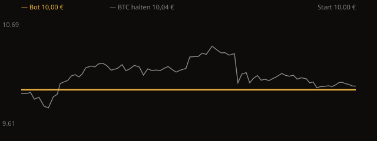

# Krypto-Scanner (Papiergeld, Kraken-Regeln)

> **Kein echtes Geld.** Gerechnet wie bei Kraken: Kauf zum Briefkurs, Verkauf zum Geldkurs, 0,40 % Gebühr, Mindestordergrößen. Vergangene Ergebnisse garantieren nichts.

**Letzter Lauf:** 28.11.2026 21:22 · **seit** 25.11.2026 09:23 (3.5 Tage, 83 Läufe)

## Stand

| | Bot | BTC halten |
| --- | --- | --- |
| Wert | **10,00 €** | 10,04 € |
| seit Start (10,00 €) | **+0,0 %** | +0,4 % |
| Gebühren bisher | 0,00 € | |
| Trades | 0 | 1 |
| größter Zwischenverlust | -0,0 % | |

## Jetzt

**Bargeld** (10,00 €): Gerade erfüllt kein Coin die Kaufregel nach Kosten.

## Gewählte Strategie

**Bargeld**, gewählt 28.11.2026 21:00 aus 12 Coins. Test der letzten 14 Tage nach Kosten:

| Strategie | Ergebnis | Trades | Zwischenverlust |
| --- | --- | --- | --- |
| **Bargeld** | +0,0 % | 0 | -0,0 % |
| BTC halten | -9,0 % | 3 | -15,6 % |
| Momentum 72 h | -22,4 % | 45 | -26,3 % |
| Momentum 24 h | -26,8 % | 52 | -26,8 % |
| Ausbruch 72 h | -28,3 % | 52 | -28,3 % |
| Ausbruch 24 h | -49,2 % | 126 | -49,2 % |
| Momentum 6 h | -52,6 % | 126 | -52,6 % |

## Ehrliche Prüfung (Walk-Forward)

Jeden Tag die Strategie gewählt, die in den 14 Tagen davor am besten war, und sie den Tag gehandelt (16 Tage, 0 Trades): **+0,0 %** gegen BTC halten -16,8 %, größter Zwischenverlust -0,0 %.

## Echtgeld-Freigabe: 🔴 noch nicht

- ❌ Mindestens 56 Tage Papierhandel: 3.5 Tage
- ❌ Mindestens 30 Trades: 0 Trades
- ❌ Nach allen Kosten im Plus: +0,0 %
- ❌ Besser als BTC halten: +0,0 % gegen +0,4 %
- ✅ Größter Zwischenverlust höchstens 30 %: -0,0 %
- ✅ Walk-Forward-Test besser als BTC halten: +0,0 % gegen -16,8 %

Auch bei Grün: nur Geld einsetzen, dessen Verlust du verkraftest, klein anfangen und weiter mitschreiben. Echte Orders sind nicht eingebaut.

## Letzte Trades

Noch keine abgeschlossenen Trades.

## Ereignisse

- 28.11.2026 16:16: Beobachte 23 Coins (Kraken, Euro, liquide)
- 28.11.2026 09:49: Beobachte 28 Coins (Kraken, Euro, liquide)
- 28.11.2026 03:40: Beobachte 30 Coins (Kraken, Euro, liquide)
- 27.11.2026 21:36: Beobachte 31 Coins (Kraken, Euro, liquide)
- 27.11.2026 14:54: Beobachte 28 Coins (Kraken, Euro, liquide)
- 27.11.2026 07:50: Beobachte 32 Coins (Kraken, Euro, liquide)
- 27.11.2026 01:15: Beobachte 31 Coins (Kraken, Euro, liquide)
- 26.11.2026 19:10: Beobachte 32 Coins (Kraken, Euro, liquide)
- 26.11.2026 12:40: Beobachte 40 Coins (Kraken, Euro, liquide)
- 26.11.2026 05:53: Beobachte 36 Coins (Kraken, Euro, liquide)

## Beobachtete Coins (23)

BTC, ETH, XRP, SOL, ZEC, LTC, HYPE, NEAR, TAO, NIGHT, DOGE, LINK …

Alle Kraken-Paare in Euro mit mindestens 250.000 € Tagesumsatz und höchstens 0,5 % Spread, ohne Stablecoins. Regeln: [krypto/STRATEGIEN.md](https://github.com/ftp2y8tcgy-max/Rich/blob/main/krypto/STRATEGIEN.md)
