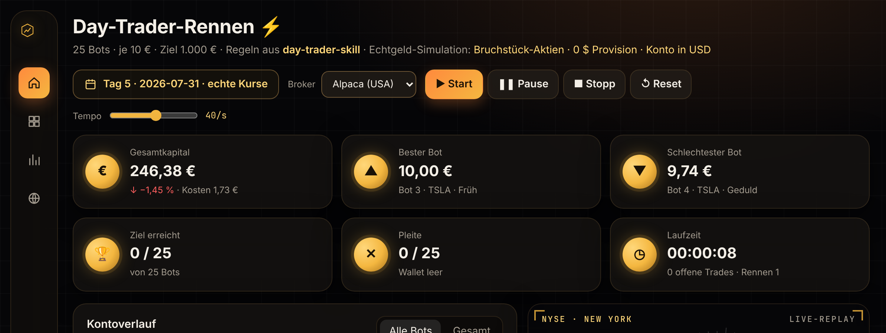

# Day-Trader-Rennen

25 Bots starten mit je 10 € und handeln US-Aktien nach den Regeln aus
[day-trader-skill](https://github.com/Jakeschincariol/day-trader-skill) (MIT). Ziel: 1.000 €.
Echtgeld-Simulation mit wählbarem Broker-Modell. Läuft auf dem iPad.

## Starten

Eine Datei: [`ipad/day_trader_rennen.py`](../ipad/day_trader_rennen.py), nur Standardbibliothek, Python 3.8+.

- **iPad** (Pythonista, Pyto oder eine andere Python-App): Datei öffnen, ▶/Ausführen.
- **Mac/PC:** `python3 ipad/day_trader_rennen.py`

Python lädt 60 Tage echte Fünf-Minuten-Kerzen von Yahoo und den EUR/USD-Kurs und baut daraus eine Seite, in der das ganze Rennen **im Browser** läuft. Pythonista und Pyto zeigen sie direkt in der App, sonst öffnet sie sich in Safari. Danach braucht die Seite Python nicht mehr, deshalb stört es nicht, wenn iOS die Python-App im Hintergrund anhält. Ohne Internet nimmt die Datei die eingebauten echten TSLA-Kerzen. Eine Kopie der Seite landet als `day_trader_rennen.html` neben der Datei.

Optionen im Terminal: `--aktien TSLA,NVDA,AMD,META,PLTR` (genau 5), `--offline`, `--nur-datei`, `--port 8765`.

## Wie die Bots handeln

Jeder Bot ist eine Aktie plus ein Regelprofil. Die Regeln sind die der Time Machine (`trader-timemachine/timemachine.py`):

1. **Eröffnungsspanne:** Hoch und Tief der ersten 5, 15 oder 30 Minuten.
2. **Signal:** erste Kerze, die über dem Hoch der Spanne schließt; keine Einstiege nach 15:30 Uhr New York.
3. **Stop:** Mitte oder Tief der Spanne oder ein Prozentwert, auf den Cent abgerundet. **Ziel:** Einstieg + R × Risiko.
4. **Ausstieg:** Stop zuerst, dann Ziel; sonst glattstellen um 15:55 Uhr. Ein Trade pro Tag, nur Kauf, kein Hebel.

| Profil | Spanne | Stop | Ziel |
| --- | --- | --- | --- |
| Lehrbuch | 15 min | Mitte | 2R |
| Reel | 15 min | Mitte | 1R |
| Früh | 5 min | Tief | 3R |
| Geduld | 30 min | Mitte | 2R |
| Eng | 15 min | 0,5 % | 4R |

Nach den echten Tagen geht es mit simulierten Tagen weiter, gezogen aus den eigenen Kerzen der Aktie zur selben Tageszeit (wie `build_pool`), im Dashboard als „Sim-Tag“ markiert.

## Echtgeld-Simulation: Broker-Modelle

Oben im Dashboard wählbar; ein Wechsel startet ein neues Rennen.

| | Alpaca (USA) – Standard | Neobroker DE | Ohne Kosten |
| --- | --- | --- | --- |
| Konto | USD; 10 € einmal getauscht, 0,5 % Wechselgebühr | EUR | USD |
| Aktien | Bruchstücke (Mindestorder 1 $) | nur ganze Aktien | Bruchstücke |
| Gebühren | 0 $ Provision; beim Verkauf SEC- (0,00278 %) und FINRA-TAF-Gebühr | 1 € pro Order, 0,1 % Spread | keine |
| Einstieg | Market-Order zum **nächsten Eröffnungskurs** + 0,05 % Slippage | dito, in € | zum Signal-Schlusskurs |
| Stop | bei Kurslücke zum Eröffnungskurs, sonst zum Stop; + Slippage | dito | genau zum Stop |
| Ziel | Limit: mindestens das Ziel | dito | genau zum Ziel |

Gebührensätze sind Näherungen (Stand 2026), keine Zusage eines Brokers. Mit dem Neobroker-Modell reichen 10 € für keine der fünf Aktien, die Bots melden das im Log. „Ohne Kosten“ rechnet exakt wie die Time Machine: Ein Test prüft, dass die Engine dort dieselben Trades macht wie `history_replay` (Profil „Reel“ auf TSLA: 33 Trades, 13 Ziel, 15 Stop, 5 Schluss, wie im README des Skills).

Bewertet wird in Euro zum EUR/USD-Tageskurs von Yahoo (ohne Internet: Annahme 1,15, im Dashboard ausgewiesen). Steuern sind nicht berücksichtigt.

## Bedienung

- **Start, Pause, Stopp** oben; **Reset** zweimal antippen; **Tempo** per Regler (Kerzen pro Sekunde).
- **Bot antippen:** Linie im Kontoverlauf hervorheben. **⤢ oder Doppelklick:** Details mit den Kerzen des Tages, Eröffnungsspanne, Kauf, Stop, Ziel, Kosten und Trade-Historie.
- **▶/❚❚ in der Kachel:** einzelnen Bot starten oder pausieren; ein offener Trade läuft nach Plan zu Ende.
- Farben: grün im Plus, rot im Minus, gold 1.000 € erreicht, grau leer.

## Dateien

| Datei | Inhalt |
| --- | --- |
| `static/engine.js` | Rennen, Bots, Broker-Modelle (läuft im Browser) |
| `static/app.js`, `app.css`, `index.html` | Oberfläche |
| `skill_bruecke.py` | lädt die Time Machine aus `.claude/skills/` (für die Tests) |
| `tests/` | `python3 -m unittest discover -s dashboard/tests -t dashboard` (braucht Node.js für engine.js) |
| `daten/TSLA-60d5m.json.gz` | echte TSLA-Kerzen aus den Testdaten des Skills (MIT) |
| `../ipad/bauen.py` | baut daraus `ipad/day_trader_rennen.py` |

Keine Anlageberatung. Es werden keine echten Orders erteilt.
