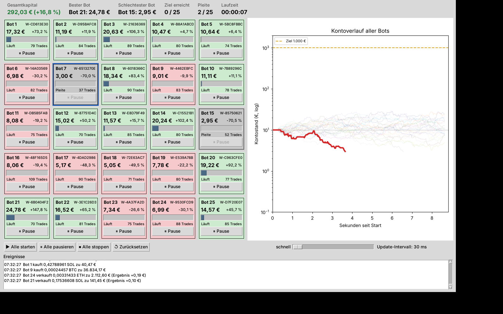

# Trading-Bot-Dashboard (Tkinter)

25 Bots laufen gleichzeitig, jeder mit eigenem Wallet und 10 € Startkapital, Ziel 1.000 €.



*(Screenshot mit gesenkten Testschwellen, damit Gold- und Grau-Kacheln sichtbar sind.)*

## Starten

Voraussetzung: Python 3.10+ mit Tkinter und matplotlib.

```bash
pip install matplotlib
# Linux zusätzlich, falls Tkinter fehlt: sudo apt install python3-tk
cd gui
python main.py               # 25 Dummy-Bots, Start per „Alle starten“
python main.py --autostart   # sofort loslegen
python main.py --bots 10 --intervall 50
```

## Bedienung

- **Klick** auf eine Kachel hebt die Linie des Bots im Chart hervor (nochmal klicken hebt auf).
- **Doppelklick** öffnet die Detailansicht mit Trade-Tabelle und Einzelchart.
- **Start/Pause** pro Kachel, darunter **Alle starten / pausieren / stoppen / Zurücksetzen**.
- **Regler** rechts: Update-Intervall von 20 ms bis 2 s (gilt für alle Bots sofort).
- Kachelfarben: grün im Plus, rot im Minus, gold = 1.000 € erreicht, grau = Wallet leer.
- Der Fortschrittsbalken ist **logarithmisch**: 10 € → 100 € ist der halbe Balken, 100 € → 1.000 € die zweite Hälfte. Linear wären die ersten 90 € kaum sichtbar.

## Dateien

| Datei | Inhalt |
| --- | --- |
| `main.py` | baut Queue, Einstellungen, Bots und Adapter, startet die GUI |
| `gui.py` | Dashboard, Kacheln, Live-Chart, Detailfenster, Steuerung, Log |
| `bot_adapter.py` | `BotAdapter`: Thread pro Bot, Steuerung, Meldungen an die Queue |
| `dummy_bot.py` | `DummyBot` mit Zufalls-Trades zum Testen |

Ablauf: Jeder Bot läuft in einem eigenen Thread. Nach jedem Schritt legt der Adapter eine Kopie von `get_state()` und neue Trades als Ereignisse in eine `queue.Queue`. Die GUI liest die Queue alle 100 ms per `root.after()` und zeichnet den Chart alle 0,7 s neu. Die GUI ruft deinen Bot nie direkt auf.

## Echten Bot anschließen

### 1. Deine Klasse braucht drei Methoden

```python
class MeinBot:
    def step(self):
        """Genau einen Handelsschritt ausführen (Kurs holen, entscheiden, handeln)."""

    def get_state(self):
        return {
            "id": 7,                    # eindeutige Bot-Nummer
            "wallet_id": "W-1234ABCD",  # beliebiger Text
            "balance": 12.34,           # Kontostand in €
            "trades": [                 # nur anhängen, alte Einträge nicht mehr ändern
                {"zeit": "12:00:01", "typ": "Kauf", "asset": "BTC",
                 "menge": 0.0002, "preis": 50000.0, "ergebnis": None},
                {"zeit": "12:05:09", "typ": "Verkauf", "asset": "BTC",
                 "menge": 0.0002, "preis": 51000.0, "ergebnis": 0.19},
            ],
            "status": "läuft",          # "ziel" oder "pleite" beendet den Handel des Bots
            "history": [(0.0, 10.0), (1.5, 10.2)],  # (Sekunden seit Start, Kontostand)
        }

    def reset(self):
        """Neues Wallet mit 10 € (für den Knopf „Zurücksetzen“)."""
```

`status` darf auch `"Ziel erreicht"`, `"goal"`, `"bankrott"`, `"broke"` usw. heißen; die Zuordnung steht in `bot_adapter.py` (`_ZIEL_WOERTER`, `_PLEITE_WOERTER`). Alles andere gilt als „läuft“. Pausiert und Gestoppt verwaltet die GUI selbst.

### 2. In `main.py` einsetzen

```python
from mein_bot import MeinBot

def bots_erzeugen(anzahl):
    return [MeinBot(bot_id=i, startkapital=10.0) for i in range(1, anzahl + 1)]
```

### 3. Wenn deine Methoden anders heißen

Leite vom Adapter ab, statt deinen Bot umzubauen:

```python
from bot_adapter import BotAdapter

class MeinAdapter(BotAdapter):
    def _schritt(self):
        self.bot.trade_once()

    def _zustand(self):
        s = self.bot.status_dict()
        return {"id": s["nr"], "wallet_id": s["wallet"], "balance": s["eur"],
                "trades": s["orders"], "status": s["state"], "history": s["verlauf"]}

    def _zuruecksetzen(self):
        self.bot.neues_wallet(10.0)
```

und in `main.py` `MeinAdapter` statt `BotAdapter` verwenden.

### Hinweise

- `step()` darf blockieren (z. B. Netzwerkabruf); das bremst nur diesen einen Bot, nicht die GUI.
- Wirft `step()` eine Ausnahme, wird der Bot pausiert und der Fehler im Log angezeigt. Die anderen laufen weiter.
- Halte `history` kurz (z. B. höchstens 2.000 Punkte, siehe `DummyBot._historie`), sonst wird das Kopieren und Zeichnen langsam.
- Bei echten Börsen-APIs auf Rate-Limits achten: 25 Bots mit 100 ms Intervall sind 250 Anfragen pro Sekunde.
